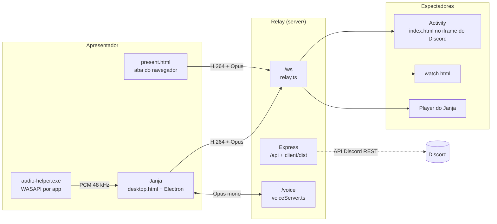
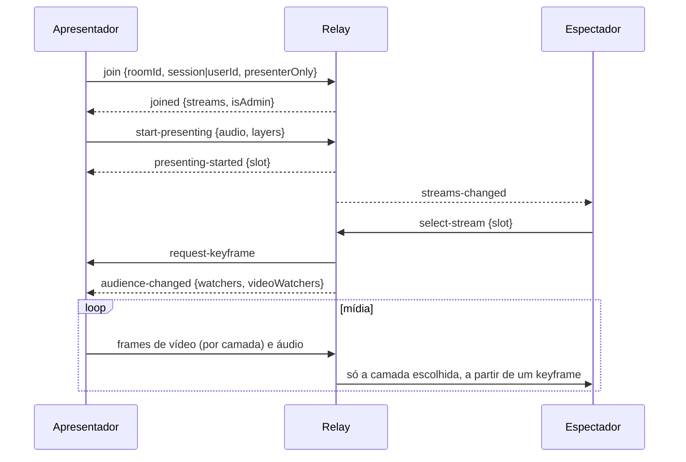

# Arquitetura

O sistema é um **relay de mídia já codificada**. Quem transmite codifica no próprio
navegador (WebCodecs) e envia frames binários por WebSocket; o servidor não decodifica nem
recodifica nada, só decide **para quem** cada frame vai. Por isso ele roda numa máquina
pequena: o custo é banda de saída (espectadores x bitrate), não CPU.

## Componentes

### `shared/`

Código usado pelos dois lados: o formato binário dos frames e as mensagens de controle
(`protocol.ts`), o protocolo das salas de voz (`voice.ts`), as constantes de qualidade,
buffers e limites (`constants.ts`) e o contrato `window.desktop` entre o preload do
Electron e a página (`desktopApi.ts`). Em dev e nos testes o Vite e o Vitest importam o
fonte TypeScript direto (alias para `shared/src/index.ts`), sem precisar recompilar.

### `server/`

Um único processo Node na porta 3001:

| Módulo | Papel |
|---|---|
| `app.ts` | Express: `/api/health`, `/api/config`, `/api/token`, `/api/desktop/*` e os arquivos de `client/dist` (com fallback para `index.html`) |
| `ws/wsServer.ts` | Encaminha cada upgrade para `/ws` ou `/voice`, com heartbeat de 20 s (ping/pong) e limite de 4 MB por mensagem |
| `ws/relay.ts` | Estado por conexão e todas as mensagens de controle do relay |
| `ws/room.ts`, `roomManager.ts` | Salas (uma por canal de voz), lives e slots; limite de salas e espectadores |
| `ws/backpressure.ts` | Descarta vídeo para quem tem mais de 2 MB na fila de saída; desconecta após 30 frames travados |
| `ws/autoLayer.ts` | Escolha automática de camada do simulcast |
| `ws/audience.ts` | Conta quem recebe cada live, para o apresentador parar de enviar quando ninguém assiste |
| `ws/joinIdentity.ts`, `viewerList.ts` | Identidade de quem entra e lista de espectadores |
| `auth/` | OAuth do Discord, sessões HMAC do Janja, checagem de canal de voz, nomes e localizador de canal |
| `voice/` | Salas de voz: estado (`voiceRooms.ts`) e WebSocket (`voiceServer.ts`) |
| `ops/ddns*.ts` | Atualiza o registro A na Cloudflare quando a hospedagem é direta de casa |

As salas vivem **só na memória**. Reiniciar o relay derruba todas as lives, e dois relays
atrás do mesmo endereço dividem as pessoas entre salas diferentes (veja
[HOSPEDAGEM.md](HOSPEDAGEM.md#dois-relays-no-mesmo-endereço)).

### `client/`

Vite com quatro páginas de entrada:

| Página | Entrada | Onde roda |
|---|---|---|
| `index.html` | `src/main.ts` → `ui/App.ts` | Activity, dentro do iframe do Discord |
| `present.html` | `src/present.ts` | Aba do navegador aberta pela Activity. O iframe do Discord nega `display-capture`, então a captura só funciona fora dele |
| `watch.html` | `src/watch.ts` → `watchView.ts` | Aba do navegador, para tela cheia real |
| `desktop.html` | `src/desktop/main.ts` | Janela do Janja, servida pelo relay |

Pastas principais:

- `capture/`: captura (`getDisplayMedia`), encoders de vídeo e áudio, e o realinhamento de
  relógios entre áudio e vídeo.
- `session/presenterSession.ts`: uma transmissão independente de página (captura → encode →
  frames), usada pela aba `present.html` e pelo Janja. `uplinkGate.ts` segura o upload.
- `playback/`: recepção (`streamReceiver.ts`), decodificação, relógio de mídia e medição de FPS.
- `ui/`: componentes compartilhados pelos três players (qualidade, espectadores, lista de
  lives, ganho, estatísticas, overlay de carregamento).
- `desktop/`: a interface do Janja (barra lateral, modal Transmitir, salas de voz, atualizações).
- `voice/`: microfone com RNNoise, gate de sensibilidade, reprodução por pessoa.

### `desktop/`

O Janja é uma casca fina: a janela carrega `desktop.html` **do servidor**, então mudanças de
interface chegam a todo mundo quando o relay é reiniciado, sem nova versão do app. O processo
principal só faz o que uma página não consegue: janela sem moldura, escolha de fonte de
captura, login por loopback, bandeja, atualizações e o helper de áudio. Detalhes em
[APP-DESKTOP.md](APP-DESKTOP.md).

## Fluxo de uma live

1. A sala é o ID do canal de voz. A Activity tira do SDK do Discord; o Janja pergunta ao
   relay (`GET /api/desktop/voice`), que procura o usuário nos servidores do bot.
2. O relay atribui um **slot** (0 a 4) por live e o grava em todo frame que repassa, ignorando
   o que o cliente mandou.
3. Cada espectador recebe **uma** live por vez (`select-stream`). Assim a saída continua
   "espectadores x bitrate", não importa quantas lives existam.
4. O relay só começa a mandar vídeo para alguém a partir de um keyframe; antes disso, deltas
   seriam banda jogada fora. Trocar de live ou de camada pede um keyframe novo.

## Simulcast e camada automática

O Janja codifica até três versões: a escolhida (camada 0) e 720p30 e 480p30 abaixo dela,
sempre no bitrate Equilibrado (`planLayers` em `constants.ts`). A camada viaja em 2 bits do
campo `flags`.

- O relay manda ao apresentador `layers-in-use`, e as camadas que ninguém recebe são pausadas.
- Em **Automático**, `autoLayer.ts` desce uma camada quando há 5 descartes em 2 s e sobe uma
  depois de 15 s limpo.
- Atrás de um proxy que bufferiza (o túnel da Cloudflare), o relay quase nunca vê a própria
  fila encher. Por isso o espectador também mede o atraso de chegada dos frames e manda
  `report-congestion`, que também faz descer.

## Economia de banda

- **Ninguém assistindo**: o relay manda `audience-changed` com 0 e o apresentador para de
  codificar e enviar. Com só ouvintes em "Somente áudio", para só o vídeo. A prévia da própria
  live conta só para o vídeo.
- **Mesma pessoa em duas conexões** (Activity + aba): a conexão antiga recebe `viewing-paused`.
  Conexões que só transmitem (`presenterOnly`) ou que não assistem nada (`watchNothing`) não
  pausam as outras.
- **Upload do apresentador**: `uplinkGate.ts` descarta vídeo quando o buffer do WebSocket passa
  de meio segundo e recomeça num keyframe. Além disso, a cada 250 ms o apresentador manda um
  `uplink-probe`; se o tempo de ida e volta sobe mais de 80 ms acima do mínimo por 500 ms, o
  bitrate cai (até 30% do original). Isso pega a fila do roteador antes de o ping do jogo subir.
- **Backpressure no relay**: áudio (cerca de 1,5% da banda) passa mesmo com a fila cheia e só é
  cortado acima de 8 MB, para não destruir a voz por causa do vídeo.

## Sincronia de áudio e vídeo

O **áudio é o relógio mestre**: o ouvido percebe um corte de 20 ms, o olho não percebe um
quadro repetido. O vídeo é apresentado contra o relógio do áudio (`playback/mediaClock.ts`).

Para isso funcionar, os dois precisam estar no mesmo relógio desde a captura:

- No Electron, os quadros de vídeo vêm com o tempo desde o boot e o loopback de áudio do
  Chromium vem em `performance.now()`. `capture/clockOffset.ts` mede a diferença e realinha o
  áudio. O áudio por app (`desktop/appAudio.ts`) faz o mesmo a partir de um quadro real.
- O `AudioEncoder` Opus do Chromium só respeita o timestamp da primeira entrada.
  `capture/captureTimeline.ts` recoloca os tempos reais de captura em cada pacote.
- No espectador, o áudio toca com 300 ms de folga (jitter buffer). Buracos menores que 40 ms
  são tratados como deriva do relógio da placa e tocados emendados; buracos maiores viram
  silêncio. Se a reprodução atrasa mais que 0,8 s, o atraso é descartado e volta ao vivo.
- O decodificador de vídeo segura no máximo 6 quadros entre o decoder e a fila: o decoder de
  hardware do Chrome tem poucas superfícies e trava se o player segurar quadros demais.

## Salas de voz

Um segundo WebSocket (`/voice`) no mesmo servidor, só para sessões do Janja. A voz passa pelo
relay (não é P2P) porque precisa atravessar o túnel. O áudio é Opus mono 48 kHz a 40 kbps, nos
mesmos frames de `protocol.ts`; o servidor grava em `slot` o assento de quem fala. Quem está
com o fone mutado não recebe áudio. Abaixo da sensibilidade escolhida nada é codificado nem
enviado.

## Segurança

- O client secret e o token do bot ficam só no servidor. O cliente pega o `client_id` em
  `/api/config` e troca o código OAuth em `/api/token`.
- Sessões do Janja são tokens HMAC-SHA256 sem estado (`uid` + expiração de 30 dias),
  comparados com `timingSafeEqual`. Uma conexão com sessão válida não pode transmitir com outro
  ID de usuário.
- Toda ação de admin é conferida no servidor contra `ADMIN_USER_IDS`.
- IDs vindos do cliente só são usados em URLs da API do Discord se forem snowflakes numéricos.
- No Janja, a sessão é cifrada com `safeStorage` (DPAPI do Windows); a janela só navega na
  origem do relay; a página tem CSP e uma lista de permissões; e o preload confere se quem
  chama é a página do relay. O nome e o avatar vindos do Discord só entram no DOM como texto.
- O relay limita mensagens a 4 MB e derruba conexões que não respondem ao ping.

## Decisões e o que ficou de fora

- **WebSocket em vez de WebRTC**: passa por qualquer proxy HTTPS (o túnel, o proxy da
  Activity) e mantém o servidor simples. O custo é TCP: perda vira atraso, não buraco. Isso é
  compensado pelo descarte de vídeo e pelo simulcast.
- **Sem banco de dados**: salas e salas de voz são efêmeras; sessões são assinadas.
- **Áudio por janela no navegador não existe**: o Chrome só oferece áudio de aba ou do sistema.
  Esse foi o principal motivo do app desktop e do helper em Rust.
- **Mídia num Worker**: não foi feito; encode e decode rodam na thread principal.
